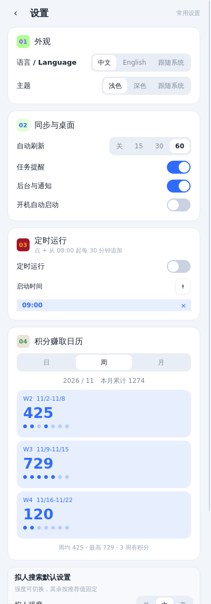

# 积分活动管理助手 2.0

一个**独立开发、非官方**的桌面小工具，用 Python + Qt 在本机查看 Microsoft Rewards 的积分、每日任务与历史记录，并设置提醒。当前版本 **2.0**。

> **非官方声明**：本项目不是 Microsoft 产品，未经 Microsoft 授权、赞助、认证或认可。文中出现的 Microsoft、Bing、Microsoft Edge、Microsoft Rewards 仅用于说明兼容环境，相关商标归其权利人所有。

| 主页 | 设置页 | 深色主题 |
| --- | --- | --- |
|  |  |  |

---

## 它能做什么

- **只读查看**：解析 `/dashboard` 与 `/earn` 两页，显示可用积分、今日积分、可领取积分，以及搜索 / 每日活动 / 日常任务的完成进度。
- **本地记录**：积分历史、积分赚取日历（日 / 周 / 月，只显示有积分的时间）、运行日志与网页快照导出。
- **提醒与托盘**：定时计划（最多 10 个时间点）、开机自启、托盘四项快捷操作。
- **界面**：浅色 / 深色 / 跟随系统、中文 / English / 跟随系统、动画常开，不弹鼠标悬浮提示。

**它不做什么**：不代填密码、不读取或导出 Cookie、不自动领取积分、不把「没读到」写成 0 分。首次登录由你本人在弹出的 Edge 窗口完成（含 MFA）。

> ⚠️ 项目还包含一个**实验性的自动完成任务链路**（打开浏览器、点击活动卡、执行电脑端搜索）。Microsoft Rewards 条款要求奖励搜索由用户本人手动进行，机器人 / 宏产生的搜索不属于合格搜索。**不要依赖这部分功能获取积分**，详见[合规与使用风险](#合规与使用风险)。

---

## 快速开始

环境：Python 3.10+、带图形桌面的 Windows / macOS / Linux，已安装 [Microsoft Edge](https://www.microsoft.com/edge)。

```bash
python3 -m venv .venv
source .venv/bin/activate          # Windows: .venv\Scripts\activate
python -m pip install -r requirements.txt
python -m rewards_assistant
```

运行时依赖只有三个：`PySide6-Essentials`、`requests`、`playwright`。只安装 Qt 核心模块（QtCore / QtGui / QtWidgets / QtSvg / QtNetwork / QtTest），不安装 `PySide6-Addons`，因此不需要 QtWebEngine / Qt3D / QtCharts / QtMultimedia，也不需要浏览器扩展。

**打包构建建议用 Python 3.12 或 3.13**，这是 Qt for Python 与 PyInstaller 回归最充分的组合。`requirements.txt` 按 `python_version` 分段：3.10~3.13 装经过完整回归的 PySide6-Essentials 6.9.x（`<6.10`），3.14 装 6.10.1+，3.15+ 装 6.12+，由 pip 选择当前解释器支持的最高兼容版本。

首次启动后，点击右上角设置 → **打开浏览器登录**，在应用弹出的独立 Edge 窗口中完成登录，再点「我已完成登录」。会话 Cookie 经加密后保存在本机数据目录（Windows 用 DPAPI，其余平台用机器绑定密钥），与你日常使用的 Edge 配置互不影响——应用不读取日常 Edge 的 Cookie 数据库；窗口不会自动关闭，登录期间可以慢慢操作。之后同步只发两个只读 HTTP 请求，不再启动浏览器。

`--widgets` 与 `--classic` 只是兼容别名，和默认命令完全等价——2.0 只有一种界面。

**多开**：想同时登录不同 Microsoft 账号，用 `--instance <id>`（或环境变量 `MS_REWARDS_INSTANCE`）为进程指定独立环境：

```bash
python -m rewards_assistant --instance work
```

每个实例拥有自己的设置、积分库、加密凭证、浏览器 profile 与日志，互不干扰；不传参数就是默认环境，沿用原有数据目录、零迁移。id 只接受 1~32 位 ASCII 字母/数字/下划线/连字符，其余一律回落默认环境。

---

## 界面与设置

设置页保持精简：**10 个可见设置**，不常改或不建议改的项目直接固定为推荐默认值。

| 分组 | 内容 |
| --- | --- |
| 外观 | 语言、主题 |
| 同步与桌面 | 自动刷新、任务提醒、后台与通知、开机自启 |
| 定时运行 | 总开关、时间胶囊（`+` 从 08:00 起按 30 分钟自动补档） |
| 积分日历 | 日（一排七个）/ 周（一排一周，含 7 个圆点）/ 月；只显示有积分的时间，无记录的未来与过去都不显示。汇总随视图切换为日均 / 周均 / 月均 |
| 拟人搜索默认设置 | **拟人强度 低 / 中 / 高**，统一控制 5 项参数 |

「拟人强度」不是摆设：切换档位会一次写齐经典 `SearchPanel` 的真实执行参数，自动完成任务的中档默认上限为 **12 轮**。表中轮数是**上限而非固定次数**：每轮会**根据任务进度**取剩余搜索次数，官方任务提前做完就提前收尾，不会为了凑满轮数空跑。

| 展示项 | 低 | 中（默认） | 高 |
| --- | --- | --- | --- |
| 搜索轮数上限 | 至多 8 轮 | 至多 12 轮 | 至多 16 轮 |
| 单轮耗时 | 10–18 秒 | 16–29 秒 | 24–40 秒 |
| 回车提交 | 35% | 50% | 70% |
| 结果点击 | 20% | 35% | 55% |
| 滚动屏数 | 0.6 屏 | 1.2 屏 | 2 屏 |

托盘菜单只有四项：**显示主页面 / 立即同步 / 自动完成任务 / 退出**。日志导出、网页快照导出、恢复默认收在设置页底部一行。

更细的架构与数据流见 [docs/ARCHITECTURE.md](docs/ARCHITECTURE.md)。

---

## 工作原理（简述）

```
登录：LoginDialog ──> 可见 Edge 窗口（本人登录 / MFA）
        └─> session.probe() 五态：已登录 / 未登录 / 部分可用 / 暂时性网络错误 / 未知

同步：SyncWorker ──> sync_once() ──> session.probe() 只读 GET /dashboard + /earn
        └─> readonly_report.build_report()  ──> 三项积分 + 任务分组 + 搜索进度
              └─> storage：页面显示值优先，失败保留上次快照

自动完成（主按钮 / 托盘 / 快捷面板）：
        Application.run_pending_tasks()  ──> SyncWorker / ActivityWorker / SearchRunner
        运行期：禁止同步、主按钮与托盘改「停止」、不做任何官方接口核验
        整轮结束：统一同步一次 → 刷新积分与任务状态
```

几个刻意的设计选择：

- 三项积分取**页面显示值**，「卡片标签 → 相邻数值」优先、RSC 字段兜底，**绝不用任务合计反推**；读不到显示 `--`，不写 0。
- 识别登录页 / 公开「关于」页直接判定为未登录，不写假的 0 分；429 / 5xx / 超时归类为「网络错误」，不会诱导重新登录。
- 搜索进度读 `pointsCounters`；读不到显示「未知」，不伪造「已满」。官方每日搜索上限按会员等级为 15 / 30 / 60 分。
- 只有两页都完整可用时才替换当日任务集合；否则保留上次快照并标记 stale。

登录与同步链路只做两页 GET，不 POST、不注入脚本、不点击活动卡、不代领积分。

---

## 项目结构

```
rewards_assistant/
├── __main__.py / app.py          入口与唯一控制器（托盘、调度、同步编排）
├── session.py / auth.py          浏览器会话、五态探测、只读门面
├── readonly_report.py           两页 HTML 解析（零依赖纯函数）
├── row_access.py                sqlite3.Row / dict / 对象统一字段取值
├── rewards_client.py / storage.py / points.py   任务结构与本地 SQLite
├── sync.py / notifier.py / autostart.py        桌面集成
├── ui/modern/                   唯一 Qt Widgets 界面
├── ui/legacy.py                 经典「自动完成未完成任务」执行内核
├── ui/login_dialog.py           登录对话框
└── api.py · browser.py · human.py · ...      实验性浏览器链路
tests/                           离线单元测试（不访问网络）
tools/render_previews.py         离屏渲染界面预览图
build_macos.sh                   macOS .app / .dmg 构建
installer/                       Windows 安装包（Inno Setup）与干净系统验证工具
.github/workflows/build.yml      自动测试 / Ubuntu deb / Windows exe / macOS dmg 打包流水线
docs/previews/                   界面截图
```

---

## 依赖

| 文件 | 用途 |
| --- | --- |
| `requirements.txt` | 运行时：`PySide6-Essentials>=6.6,<6.10`（Python < 3.14）/ `PySide6-Essentials>=6.10.1`（Python ≥ 3.14）、`requests>=2.28`、`playwright>=1.40` |
| `requirements-build.txt` | 在运行时依赖之上加 `pyinstaller>=6.0` |
| `requirements-dev.txt` | 在运行时依赖之上加 `pytest>=8.0`，仅供本地与 CI 测试 |

`PySide6-Essentials` 只含项目实际用到的 Qt 模块；打包时由 PyInstaller 的官方 Qt hook 按实际 import 图收集，不会把 QtWebEngine 等扩展打进安装包。`requests` 是首选 HTTP 后端，环境缺它时同步链路自动切到标准库 `urllib`。

---

## 构建安装包

**Debian / Ubuntu**（需 `dpkg-dev`，建议装 `python3-venv`；缺失时脚本会自动回退系统解释器）：

```bash
chmod +x build_deb.sh build_ubuntu.sh
./build_deb.sh                    # PyInstaller 打包 + dpkg-deb 封装，一步完成
sudo apt install ./deb-dist/*.deb
```

已有 `dist/MSRewardsAssistant/` 时可只重新封装：`./build_deb.sh --package-only`。构建脚本会检查产物完整性，避免把被中断的构建封成残缺包。`Depends` 已覆盖 Qt xcb 平台插件所需的系统库，并兼容 Ubuntu 24.04 的 `t64` 包名。`.deb` 版本号取自 `config.APP_VERSION`（当前 `2.0`）。

> `Depends` 中的 `libxcb-cursor0` 在 Ubuntu 22.04 官方源里没有；Ubuntu 24.04 / Debian 12+ 可直接 `apt install` 装齐，22.04 需自行提供该库后才能启动 xcb 平台插件。CI 的 Ubuntu job 会尽力安装它，缺失时只记一条非致命警告。

**macOS**：在 macOS 本机运行 `bash build_macos.sh`，产出 `dist/MSRewardsAssistant.app` 和 `macos-dist/MSRewardsAssistant_2.0_<架构>.dmg`。DMG 内带一个指向 `/Applications` 的链接，把 .app 拖进去即完成安装；架构（arm64 / x86_64）跟随构建机，不合并 universal2。PyInstaller 不能跨平台编译，macOS 产物必须在 macOS 上构建，spec 的 `BUNDLE` 分支仅在 `sys.platform == 'darwin'` 生效，Linux / Windows 构建不受影响。

脚本只用系统自带工具：`sips` + `iconutil` 从 `assets/icons/app_512.png` 生成 `.icns` 应用图标，`plutil` / `codesign` 校验应用包，`ditto` / `hdiutil` 封装压缩 DMG；不引入任何第三方打包依赖。`--no-dmg` 只出 .app，`--package-only` 复用已有 dist 重新封镜像。构建后会核对 `Info.plist`、Qt cocoa 平台插件、`base_library.zip`、Frameworks 里真实的 shiboken6 动态库与 ad-hoc 签名，避免交付一个 Finder 里能看见、双击却起不来的包。

应用包是 ad-hoc 签名、未公证：从网络下载后 Gatekeeper 可能拦下，右键「打开」或执行 `xattr -dr com.apple.quarantine /Applications/MSRewardsAssistant.app` 即可。正式对外分发需要 Apple Developer 账号做 Developer ID 签名与公证，这一步不在脚本内。用户数据在 `~/Library/Application Support/MSRewardsAssistant`，把 .app 拖进废纸篓不会删除数据。

**Windows**：运行 `build_windows.bat`，同样使用 `MSRewardsAssistant.spec`，产物在 `dist/MSRewardsAssistant/`。EXE 图标由 spec 内嵌的 `assets/icons/app.ico` 提供（7 种尺寸），资源管理器与任务栏即可显示；源码运行时窗口图标走 `QApplication.setWindowIcon()`，两者互不影响。

spec 会把 `shiboken6` / `libshiboken6` 动态库**显式平铺**到 `_internal` 根目录，构建脚本随后用 `tools/normalize_bundle.py` 校验。PyInstaller 6.x 的 Qt hook 可能只把它放进子目录或留下 symlink，而动态加载器按 `_internal` 搜索，缺失时就会报 `libshiboken6.abi3.so: cannot open shared object file` / `shiboken6.abi3.dll: The specified module could not be found`；显式平铺保证各种 venv 布局与文件系统上都能打开。

**Windows 一键安装包（Inno Setup）**：先在构建机装一次免费的 [Inno Setup 6.5+](https://jrsoftware.org/isdl.php)，然后在项目根目录运行 `installer\build_inno.bat`，它会用 `ISCC.exe` 编译 `installer\setup.iss`，把 `dist\MSRewardsAssistant\` 的全部文件（含 `_internal` 子目录）压成一个自带**图形化中文安装向导**的单文件 `MSRewardsAssistantSetup.exe`。双击即自动安装到 `%LOCALAPPDATA%\Programs\MSRewardsAssistant`，自动创建桌面图标、开始菜单图标与卸载入口（支持「设置 → 应用」卸载），无需 UAC、无需联网、无需同目录其他文件。Inno Setup 只在**打包时**需要；生成的 exe 对最终用户零依赖，项目也不新增任何 Python 包。支持 `/VERYSILENT` 静默安装，也可用 `installer\build_inno.bat --open` 打开图形化编译器，详见 [installer/README.md](installer/README.md)。**别在开发机上验证安装包**：应在干净虚拟机 / Windows Sandbox 里断网、用标准用户、只拷那一个 exe 测试，方法见 [installer/verify_clean_vm.md](installer/verify_clean_vm.md)（附自动检查脚本 `verify_setup.ps1`）。

自动化链路每次运行都在**全新的唯一浏览器配置快照**里启动，不需要关闭你日常打开的 Edge；上一轮窗口被提前关闭也不会影响下一次。启动若因残留进程退出，会自动换一份全新配置重试，重试失败才给出提示。运行日志只记录 IP 网段，不写完整公网地址。

**自动运行期间的防误操作**：浏览器任务执行时，主页主按钮与托盘第 3 项一起变成「停止自动运行」，点击只做停止（停止请求发出后按钮立即锁定，避免连点）；「立即同步」「刷新」、顶部放大镜和快捷键全部禁用，定时自动同步与定时启动请求也不会插队。运行期间不做任何官方接口核验，整轮结束后统一同步一次并刷新界面；进度与积分以官网为准。

**构建一律使用系统 Python（不创建虚拟环境）**：四个构建脚本都直接调用系统解释器（Windows 可用 `set PYTHON=py -3.13` 指定，Linux 用 `PYTHON=python3.13 ./build_ubuntu.sh`，macOS 用 `PYTHON=python3.13 bash build_macos.sh`），只安装缺失依赖、不升级系统 pip。统一使用系统解释器这一单一来源，可避免自建虚拟环境与系统 `site-packages` 混用引入的导入层污染：`requests.Session` 被 `lazy_import` 代理对象替换时会出现 `'lazy_import' object is not callable`，同步链路另备标准库 `urllib` 后端兜底。源码**运行**时仍可照常用 `python3 -m venv .venv`，两者互不冲突。

构建脚本会打印实际使用的 Python 版本。常见问题：

- **`No matching distribution found for PySide6`**：镜像未同步对应 wheel，或 Python 版本过新。确认清单已按 `python_version` 分段后，换官方源重试：
  ```bat
  python -m pip install -i https://pypi.org/simple -r requirements-build.txt
  ```
- **想换 Python 版本构建**（例如从 3.15 换到 3.13）：直接指定解释器重跑即可：
  ```bat
  set PYTHON=py -3.13
  build_windows.bat
  ```
  Linux 侧对应 `PYTHON=python3.13 ./build_ubuntu.sh`，macOS 侧对应 `PYTHON=python3.13 bash build_macos.sh`。

跨架构构建、不同桌面环境的托盘表现不作保证；macOS 产物同样不跨架构通用。

---

## GitHub Actions 自动打包

`.github/workflows/build.yml` 在推送 `main`、推送 `v*` 标签、PR 与手动触发时运行，先跑离线测试，再并行产出三个平台的安装包。

| Job | Runner | 产物 |
| --- | --- | --- |
| `test` | ubuntu-22.04 | 离线测试（Qt offscreen）与构建脚本语法检查 |
| `ubuntu` | ubuntu-22.04 | `ms-rewards-assistant_<版本>_amd64.deb` |
| `windows` | windows-latest | `MSRewardsAssistantSetup.exe`（Inno Setup 图形向导） |
| `macos` | macos-latest | `MSRewardsAssistant_2.0_<arch>.dmg`（内含 .app） |

- `test` job 在跑 pytest 前先装 `libegl1` / `libgl1` 等 Qt 基础运行库，并单独验证 `PySide6.QtWidgets` / `QtGui` / `QtTest` 能导入。`QT_QPA_PLATFORM=offscreen` 只选择平台插件，不能替代系统库：`libQt6Gui.so.6` 在 import 阶段就按 `DT_NEEDED` 解析 `libEGL.so.1`，runner 缺它时测试收集会直接 `ImportError`，且三个打包 job 都 `needs: test`，会一起被跳过。
- 四个需要 Python 的 job 统一用 3.12 与系统解释器；Ubuntu 侧显式设 `PYTHON=python` 锁定 `setup-python` 的解释器，避免 runner 自带的系统 `python3` 被误用。Ubuntu 侧由 `build_deb.sh` 串联 `build_ubuntu.sh`、PyInstaller 与 `dpkg-deb`；Windows 侧由 `build_windows.bat` 产出 onedir，再用 `installer\build_inno.bat --no-build` 压成单文件 exe（不加静默参数，保留 ISCC 编译日志便于 CI 排错）；macOS 侧由 `build_macos.sh` 生成 .app 与 DMG，架构跟随 runner。
- Ubuntu job 先补齐 Qt xcb 运行库；Ubuntu 22.04 的源没有 `libxcb-cursor0`，它会单独尽力安装，缺失时只留一条非致命警告，平台插件仍随包携带。Windows job 用 Chocolatey 安装 Inno Setup，它只存在于打包机。macOS job 使用系统自带的签名与镜像工具，不需要额外安装。
- 三个打包 job 都对产物做实质校验：Ubuntu 侧逐项核对主程序、`base_library.zip`、`libqxcb.so`、图标、Playwright driver，确认顶层 shiboken6 是真实文件、包版本与 `config.APP_VERSION` 一致；Windows 侧核对 exe 大小、`ProductVersion` 与 `_internal` 顶层 shiboken6 DLL 非 symlink；macOS 侧校验 `Info.plist` 版本、`libqcocoa.dylib`、`codesign --verify --deep --strict` 与 DMG 可读性。cmd 步骤显式传递退出码，避免批处理失败被吞掉。
- 产物通过 `actions/upload-artifact` 上传，保留 30 天。推送 `v*` 标签时，`release` job 会先确认三个平台的包都在，再把它们挂到 GitHub Release。
- 版本号不在 workflow 里维护：`.deb` 取自 `config.APP_VERSION`，Windows 取自 `installer/setup.iss` 的 `MyAppVersion`，macOS 由 `BUNDLE(version=APP_VERSION)` 写进 `Info.plist`，三处当前均为 `2.0`。

---

## 测试

```bash
python -m pip install -r requirements-dev.txt
python -m pytest -q
```

测试全部离线运行、不访问网络、不需要登录；少数需要真实显示环境的交互用例会在无图形环境下自动跳过。预览图可离线重渲：

```bash
python tools/render_previews.py
```

---

## 本地数据与隐私

- 配置、积分历史、运行日志与浏览器登录态都保存在用户数据目录，Linux 默认为 `~/.local/share/msrewardsassistant/`，可用 `MS_REWARDS_HOME` 覆盖。
- 应用**不把 Cookie 写成明文文件**；遗留的明文 `cookies.txt` 会由迁移逻辑一次性导入加密存储后删除，`browser_profile/` 本身包含登录状态，请视为敏感数据，不要打包或分享；日志中的邮箱 / 长令牌会先脱敏。
- `.gitignore` 已排除凭证、数据库、日志、浏览器目录与构建产物。忽略规则无法抹掉 Git 历史，公开仓库前请自行检查提交记录；若凭证有外泄风险，请在官网重新登录使其失效。
- 程序会直接访问 Microsoft / Bing 页面，热搜关键词等功能还可能访问其他站点与 IP 归属服务，相关请求受目标站点隐私政策约束。

---

## 合规与使用风险

本项目包含与第三方网站交互的实验性功能，不代表已取得服务方许可。

**Microsoft Rewards 条款对奖励搜索有明确限制**：合格搜索须为用户本人出于真实研究目的手动进行的搜索；机器人、宏或其他自动化方式产生的搜索不属于合格搜索，Microsoft 也明确建议不要用程序、机器人或宏辅助 Rewards 搜索。使用自动化功能可能导致无法获得积分、积分作废或账户受限。**请以人工操作和官方要求为准，不要依赖本项目的自动化搜索功能获得积分。**

自动点击活动卡不等于完成活动：部分活动需要答题、领取或其他互动，进度与积分以服务端最终记录为准。页面结构、接口或服务规则变化后功能可能失效。`可领取` 积分必须在 [rewards.bing.com](https://rewards.bing.com) 由用户手动领取（通常为可领取后 30 天内有效）；「今日积分」与任务合计不必相等（周任务、额外奖励分等）。

参考：

- [Microsoft 服务协议](https://www.microsoft.com/en-us/servicesagreement)
- [Microsoft Rewards 搜索限制说明](https://support.microsoft.com/en-us/accounts-billing/rewards/limiting-your-searches-in-microsoft-rewards)
- [Microsoft 商标与品牌使用规范](https://www.microsoft.com/en-us/legal/intellectualproperty/trademarks)

以上仅提示已知风险，不构成法律意见，也不保证任何使用方式合规。公开发布、分发二进制或投入实际使用前，请自行核实适用条款与当地法律。

---

## 许可证

**本仓库目前未随附项目级开源许可证。** 公开源码并不自动授予复制、修改、再分发等权利。维护者应在确认全部代码与素材的权利归属后，按实际授权意愿添加 `LICENSE`；在此之前，请勿将本项目描述为已获得某种开源许可。

第三方依赖（PySide6-Essentials、requests、Playwright 等）各自许可独立适用。发布 `.deb` 或 Windows 二进制前，请核对依赖许可义务，以及应用名称、图标、图片等资源的商标与版权风险。

---

本仓库为社区独立项目。问题反馈请使用 GitHub Issues，**切勿公开账户 Cookie、密码、令牌或个人浏览记录**。
