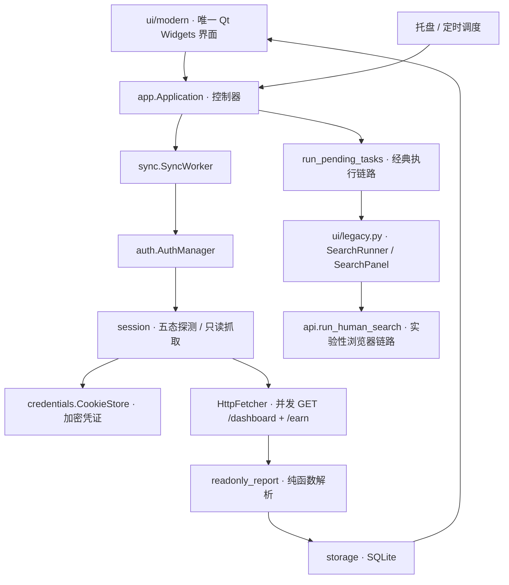
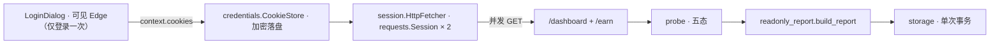

# 架构说明

面向维护者的简要说明。用户向导读 [README.md](../README.md)。

## 分层



- **数据与解析层**（不依赖 Qt）：`credentials` / `session` / `auth` / `readonly_report` / `rewards_client` / `storage` / `points`。
- **桌面集成**：`sync` / `notifier` / `autostart`。
- **界面与控制器**：`ui/modern/` + `app.py`。`--widgets` / `--classic` 只是入口别名，不存在第二套窗口。

## 只读同步

`session.probe()` 用两页 HTML 与 HTTP 状态给出五态：`SIGNED_IN` / `SIGNED_OUT` / `DEGRADED` / `TRANSIENT_ERROR` / `UNKNOWN`。两页由 `HttpFetcher.fetch_many()` 用纯 HTTP **并发** GET（凭证来自加密的 `CookieStore`），同步路径不启动浏览器；网络错误不会被翻译成「凭证失效」。

`readonly_report.build_report()` 是零第三方依赖的纯函数：

1. 三项积分按「卡片标签 → 相邻数值」解析，RSC 字段兜底，两页合并；缺失为 `None`，不用任务合计反推，不写 0。
2. 任务卡同时吃 RSC `dailySetItems` 与可见 DOM 绿色徽章卡，按最近 `<h2>` 分组、两页去重。
3. `pointsCounters` 读不到返回 `None`（官方每日搜索上限按等级为 15 / 30 / 60 分，不硬编码 60/60）。
4. 识别登录页 / 公开「关于」页直接返回 `signed_out`。

落库时「今日积分」优先取页面显示值；失败保留上次快照并标记 stale，不覆盖、不清空任务。整段写入（批量 UPSERT 任务、余额、页面真值、刷新汇总）由可重入的 `Store.tx()` 包成一次 SQLite 事务。`to_legacy_dashboard()` 把结果转成 `rewards_client.parse_dashboard()` 能读的兼容结构，供经典链路复用。

## 设置映射

`ui/modern/viewmodel.py` 把可见控件直接写入经典 `Settings` 键，不是另存一套界面偏好：

| 控件 | 写入 |
| --- | --- |
| 自动刷新 | `sync_interval_minutes` + `sync_interval_value_minutes` |
| 任务提醒 | `remind_time` / `remind_time_value` / `evening_remind_time` / `evening_remind_time_value` |
| 后台与通知 | `notify_after_sync` / `silent_when_all_done` / `close_to_tray` |
| 拟人强度 低/中/高 | 一次写齐 `search_panel` 的 8 个执行参数，默认 12 轮 |
| 时间胶囊 | `auto_run_times`（08:00 起每 30 分钟补第一个空档） |

隐藏项由 `defaults_patch()` 一次性写成推荐默认值（带迁移标记，不覆盖用户后续选择）；旧配置由 `intensity_upgrade_patch()` / `repeat_upgrade_patch()` 平滑升级。`config.SEARCH_PANEL_KEYS` 是持久化白名单，`SearchPanel._collect()` 负责把参数透传给 `api.run_human_search()`。

纯界面偏好只有 `ui_language` / `ui_theme` / `ui_calendar_view`。

## 同步性能：凭证与浏览器解耦

慢的根源不是解析或 SQLite，而是「登录态」曾被绑在浏览器进程上：为了发两个 GET，每次都要启动 Playwright 驱动、加载 Edge 持久化 profile、并发取数、关闭 context、停止驱动。常驻 headless context 只能摊薄这笔开销，还会带来锁与后台进程。现在**同步链路完全不启动 Chromium**。



- `CookieStore` 加密保存会话 Cookie：Windows 用 DPAPI（`CryptProtectData`，绑定当前用户），其他平台用机器绑定种子 + PBKDF2-SHA256 派生密钥 + SHAKE256 流加密 + HMAC-SHA256 认证（encrypt-then-MAC），文件权限 0600、原子替换。损坏、篡改或换机器一律当作「尚未保存会话」，重新登录即可。**不读取日常 Edge 的 Cookie 数据库**（新版 app-bound encryption 且运行中 DB 被独占）。
- 只保留 `RELEVANT_SUFFIXES` 里的 Microsoft 相关域；无关站点 Cookie 不落盘、不随请求带出。旧版明文 `cookies.txt` 由 `migrate_legacy()` 一次性导入后删除。
- `HttpFetcher.fetch_many()` 实现与 `BrowserSessionFetcher` 相同的 `ReadOnlyFetcher` 接口：每页一个独立 `requests.Session`（Session 不保证线程安全），线程池并发两个白名单 GET；单页异常只返回 `transient`，不误判登录失效。无凭证时直接返回 `signed_out`，连网络往返都省掉。
- `default_fetcher()` 恒返回 `HttpFetcher`。`probe()` / `sync_once()` / `readonly_report` / `storage` / UI 全部不变；`BrowserSessionFetcher` 只保留给登录窗口与「退出登录」清理 profile 使用，不在同步热路径上。
- 因此 `profile_guard` 只保护登录 / 清理这两类低频浏览器操作，同步与登录窗口不再抢锁；上一版为常驻会话加的四个释放点、回退分支整套删除。

按模拟冷启动 1.5 秒、单页 0.35 秒跑真实代码路径：

| 同步次数 | 每次启停浏览器 | 常驻 context（已移除） | 纯 HTTP |
| --- | --- | --- | --- |
| 1 次 | 1.86s | 1.86s | **0.38s** |
| 3 次 | 5.56s | 2.56s | **1.14s** |

### 其余性能约束

- `readonly_report.build_report()` 每页只 `decode_payload()` 一次；`_heading_sections()` 一次扫描全页 `<h2>`，`visible_cards_from()` 用二分查找取最近分组，替代原先每张卡都从头扫 HTML 的 O(n²) 逻辑。
- `sync_once()` 把任务批量 UPSERT、余额、页面真值与刷新汇总包进一个可重入事务，只提交一次；首屏同步在窗口显示的同时启动（0 延迟）。
- 这些优化不改变「读不到不写 0、失败保留快照、运行期不同步、只 GET 两个白名单页面」的口径。

## 积分赚取日历

`viewmodel._points_by_day()` 先把历史记录收敛成「有积分的日期」，未来 / 过去为 0 分的日期一律不进入界面：

- **日**：本月有积分的日子，一排七个紧凑卡片；
- **周**：本月涉及到的周（周一至周日），一排一周，标签如 `W3  11/9-11/15`，第二排是周合计，第三排 7 个圆点对应当天是否有积分；
- **月**：只列出有积分的月份，第三排圆点按该月各周是否有积分。

三种视图共用 `CalendarCell`（圆角矩形内三排：标签 / 蓝色粗体积分 / 圆点），`CalendarGrid` 按 `cell["unit"]` 决定 7 列或 1 列。`calendar_summary()` 的口径随视图变为日均 / 周均 / 月均，并给出最高与有积分的计数；原先单独一行、两个同色圆点的图例已改为卡片内的第三排圆点。

## 自动完成任务

主页主按钮、托盘动作、快捷面板都调用 `Application.run_pending_tasks()`，与 1.3.0 经典窗口同一份 Python 代码：

```
SyncWorker（同步未完成任务）→ ActivityWorker（活动卡点击）
→ SearchRunner / api.run_human_search（电脑端搜索）→ sync_now(auto=True)
```

这是**实验性链路**，但登录态与只读同步**同源**：都来自 `credentials.CookieStore` 的本机加密凭证。同步用 `HttpFetcher` 直接发 HTTP；自动化用 `browser.new_automation_profile_dir()` 创建一份**全新且空**的 user-data-dir，启动 Edge 后由 `inject_saved_cookies()` 用 `ctx.add_cookies()` 把凭证注入 context。

**不复制、不读取任何已有 profile**（旧版 `copy_profile()` 整套已删除）：没有 `SingletonLock` / `ProcessSingleton` / `shutil.Error`，没有「残留进程把新启动 handoff 给自己后退出」，Chromium 的 process singleton 按 user-data-dir 路径判定、唯一空目录即可彻底断开这条链；登录窗口与后台同步也不再和它抢目录。`playwright_cookies()` 负责把加密凭证转成 Playwright 结构：会话 Cookie（`expires <= 0`）必须省略 `expires`，迁移来的 hostless 项用 `url` 代替 `domain`/`path`；批量注入失败会逐条兜底并跳过畸形项。凭证为空时 `launch_automation_edge()` 直接抛「尚未保存登录会话」，不启动一个必定退出的浏览器。目录在运行结束后删除，最多保留 3 份历史；仅在极少数瞬时目录占用时换一份全新目录重试一次。

启动失败的可观测性：`launch_automation_edge(log=...)` 把 `credentials`（凭证条数）、`profile`（全新空目录）、`edge`（启动成功/失败）、`cookies`（注入条数）逐阶段写进运行日志；`api.run_human_search()` 在启动异常分支先写 `browser_error: 异常类型: 原因`，再安全 `pw.stop()` 并以 `session_end error: 原因` 收尾，主循环异常的 `finally` 同样区分 `ok` / `error`。`SearchWorker` 不再只发多行 traceback，而是先发一条单行完整原因（`error`），再把栈帧压成一行（`trace`）；界面日志上限从 200 提到 500 字符。这三处一起解决了「日志只剩两帧文件路径、`session_end done` 却失败、真正原因被截断」的问题。

启动健壮性：`launch_edge()` 在 `channel="msedge"` 解析不到 Edge 时自动改用 `find_edge_binary()` 的绝对路径；`launch_automation_edge()` 对占用类错误换全新空目录重试、对参数不兼容类错误（`Unexpected option` / `no_viewport` / `permissions` 等）降级为最小参数集重试，其余错误（没装 Edge、凭证为空）直接给出明确提示、不空转。

运行期互斥：``Application.auto_running()`` 为真时，``sync_now()`` 直接拒绝手动同步、定时同步静默跳过；主按钮与托盘第 3 项切换为「停止自动运行」，主按钮同时通过 ``danger`` 动态属性切到红色 QSS（浅色 / 深色各一套），窗口统一禁用 ``act_sync`` / 圆环 / 顶部放大镜，并锁定停止按钮防连点。

主页交互：`RingProgress` 是 `QAbstractButton`，本身就是唯一的显式手动刷新入口（任务卡头部的文字按钮已删除）。hover 时 1500ms 无限呼吸动画驱动光晕透明度、弧宽、外扩 2px、末端高光点、中心字号，圆环内小字从「今日任务」换成「点击刷新」——用内置文字而非悬浮提示框表达可点击性；移出 / 禁用立即归零。点击与左上角放大镜都走 `HomePage._on_refresh_clicked()`，运行期或同步期直接 return。任务行的 `numBadge` 不再按分组区分 `flat` / `accent`，搜索 60 分与活动 `+10` 使用完全相同的绿色圆角徽章。整轮结束的 ``running → idle`` 边沿调用 ``_on_auto_run_finished()``，只补一次同步（``_post_run_sync_pending`` 去重）。活动点击期间不做任何官方接口核验 / 请求，活动与搜索之间也不插入同步，避免同步与浏览器任务并行；同步结束后状态行从「正在…」切换为完成态，不会残留。

Microsoft Rewards 要求奖励搜索由本人手动进行，不建议用它获取积分；详见 README 的合规章节。

## 构建

`build_ubuntu.sh` / `build_windows.bat` 都使用统一的 `MSRewardsAssistant.spec`：图标、可选字体、Playwright 驱动由 spec 收集，Qt 模块交给 PyInstaller 官方 hook 按 import 图收集。`build_deb.sh` 负责封装 `.deb`、`Depends` 系统库与完整性检查。

链路细节与约束以源码注释为准；本文件只描述结构，不记录开发过程。
