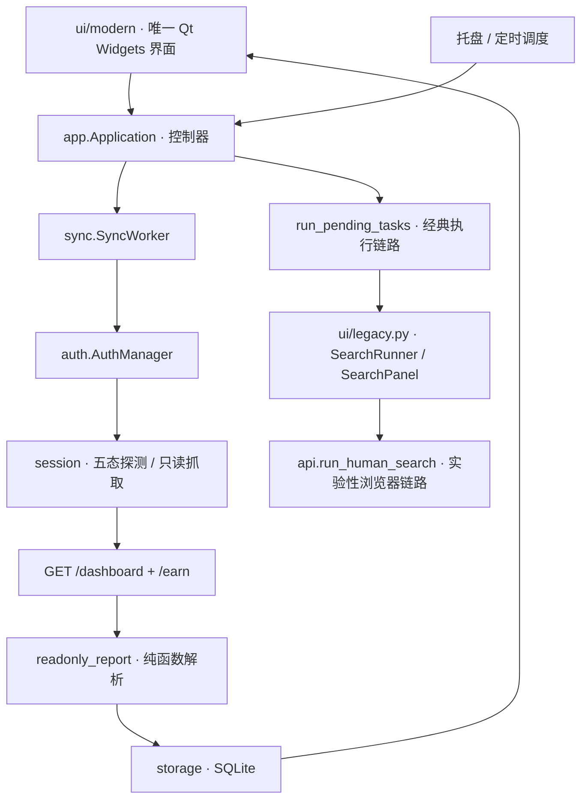

# 架构说明

面向维护者的简要说明。用户向导读 [README.md](../README.md)。

## 分层



- **数据与解析层**（不依赖 Qt）：`session` / `auth` / `readonly_report` / `rewards_client` / `storage` / `points`。
- **桌面集成**：`sync` / `notifier` / `autostart`。
- **界面与控制器**：`ui/modern/` + `app.py`。`--widgets` / `--classic` 只是入口别名，不存在第二套窗口。

## 只读同步

`session.probe()` 用两页 HTML 与 HTTP 状态给出五态：`SIGNED_IN` / `SIGNED_OUT` / `DEGRADED` / `TRANSIENT_ERROR` / `UNKNOWN`。网络错误不会被翻译成「凭证失效」。

`readonly_report.build_report()` 是零第三方依赖的纯函数：

1. 三项积分按「卡片标签 → 相邻数值」解析，RSC 字段兜底，两页合并；缺失为 `None`，不用任务合计反推，不写 0。
2. 任务卡同时吃 RSC `dailySetItems` 与可见 DOM 绿色徽章卡，按最近 `<h2>` 分组、两页去重。
3. `pointsCounters` 读不到返回 `None`（官方每日搜索上限按等级为 15 / 30 / 60 分，不硬编码 60/60）。
4. 识别登录页 / 公开「关于」页直接返回 `signed_out`。

落库时「今日积分」优先取页面显示值；失败保留上次快照并标记 stale，不覆盖、不清空任务。`to_legacy_dashboard()` 把结果转成 `rewards_client.parse_dashboard()` 能读的兼容结构，供经典链路复用。

## 设置映射

`ui/modern/viewmodel.py` 把可见控件直接写入经典 `Settings` 键，不是另存一套界面偏好：

| 控件 | 写入 |
| --- | --- |
| 自动刷新 | `sync_interval_minutes` + `sync_interval_value_minutes` |
| 任务提醒 | `remind_time` / `remind_time_value` / `evening_remind_time` / `evening_remind_time_value` |
| 后台与通知 | `notify_after_sync` / `silent_when_all_done` / `close_to_tray` |
| 拟人强度 低/中/高 | 一次写齐 `search_panel` 的 8 个执行参数，默认 12 轮 |
| 时间胶囊 | `auto_run_times`（08:00 起每 30 分钟补第一个空档） |

隐藏项由 `defaults_patch()` 一次性写成推荐默认值（带迁移标记，不覆盖用户后续选择）；旧配置由 `intensity_upgrade_patch()` / `repeat_upgrade_patch()` 平滑升级。`config.SEARCH_PANEL_KEYS` 是持久化白名单，`SearchPanel._collect()` 负责把参数透传给 `api.run_human_search()`。

纯界面偏好只有 `ui_language` / `ui_theme` / `ui_calendar_view`。

## 积分赚取日历

`viewmodel._points_by_day()` 先把历史记录收敛成「有积分的日期」，未来 / 过去为 0 分的日期一律不进入界面：

- **日**：本月有积分的日子，一排七个紧凑卡片；
- **周**：本月涉及到的周（周一至周日），一排一周，标签如 `W3  11/9-11/15`，第二排是周合计，第三排 7 个圆点对应当天是否有积分；
- **月**：只列出有积分的月份，第三排圆点按该月各周是否有积分。

三种视图共用 `CalendarCell`（圆角矩形内三排：标签 / 蓝色粗体积分 / 圆点），`CalendarGrid` 按 `cell["unit"]` 决定 7 列或 1 列。`calendar_summary()` 的口径随视图变为日均 / 周均 / 月均，并给出最高与有积分的计数；原先单独一行、两个同色圆点的图例已改为卡片内的第三排圆点。

## 自动完成任务

主页主按钮、托盘动作、快捷面板都调用 `Application.run_pending_tasks()`，与 1.3.0 经典窗口同一份 Python 代码：

```
SyncWorker（同步未完成任务）→ ActivityWorker（活动卡点击）
→ SearchRunner / api.run_human_search（电脑端搜索）→ sync_now(auto=True)
```

这是**实验性链路**，与只读同步层相互独立。两者使用不同的浏览器配置：只读同步用 `config.profile_dir()`（应用独立登录 profile），自动化用 `browser.new_automation_profile_dir()` —— **每次运行一份全新且唯一**的 `copy_profile()` 快照，运行结束后删除、最多保留 3 份历史。固定复用同一个目录会让上一轮残留的 Edge 进程把新启动 handoff 给自己后退出，Playwright 报 `Target page, context or browser has been closed`；`launch_automation_edge()` 在遇到这类冲突时会换全新目录自动重试一次。因此日常 Edge 正在运行、后台同步进行、或上一轮窗口被提前关闭，都不会再触发 `ProcessSingleton` / 文件占用错误。复制时逐文件跳过锁文件与 WAL，单文件失败不影响整份快照。

运行期互斥：``Application.auto_running()`` 为真时，``sync_now()`` 直接拒绝手动同步、定时同步静默跳过；主按钮与托盘第 3 项切换为「停止自动运行」，窗口统一禁用 ``act_sync`` / 刷新按钮 / 顶部放大镜，并锁定停止按钮防连点。整轮结束的 ``running → idle`` 边沿调用 ``_on_auto_run_finished()``，只补一次同步（``_post_run_sync_pending`` 去重）。活动点击期间不做任何官方接口核验 / 请求，活动与搜索之间也不插入同步，避免同步与浏览器任务并行；同步结束后状态行从「正在…」切换为完成态，不会残留。

Microsoft Rewards 要求奖励搜索由本人手动进行，不建议用它获取积分；详见 README 的合规章节。

## 构建

`build_ubuntu.sh` / `build_windows.bat` 都使用统一的 `MSRewardsAssistant.spec`：图标、可选字体、Playwright 驱动由 spec 收集，Qt 模块交给 PyInstaller 官方 hook 按 import 图收集。`build_deb.sh` 负责封装 `.deb`、`Depends` 系统库与完整性检查。

链路细节与约束以源码注释为准；本文件只描述结构，不记录开发过程。
