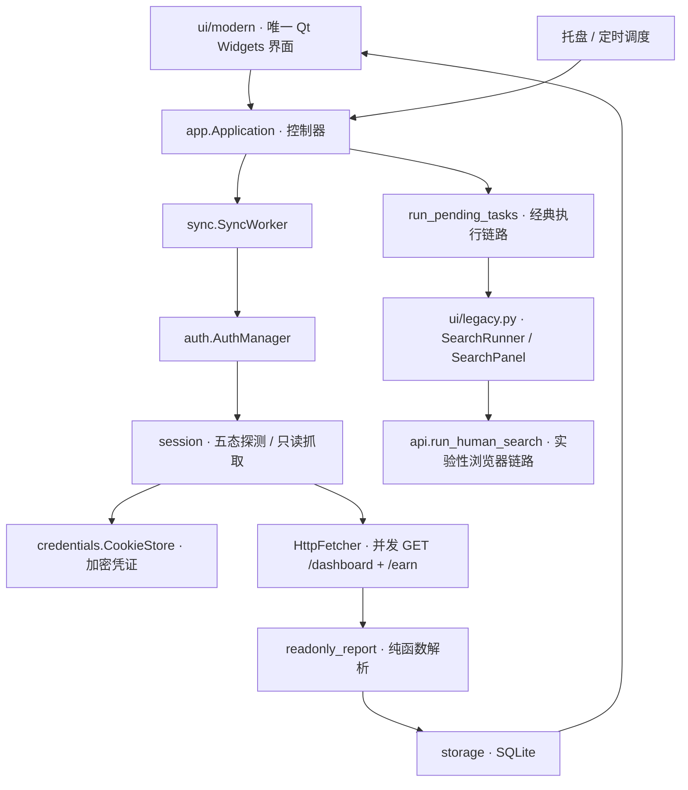
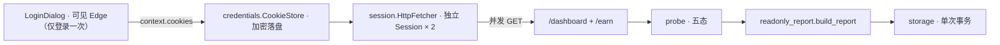

# 架构说明（2.0）

面向维护者的简要说明，描述当前版本的分层、数据流与设计约束。用户向导读 [README.md](../README.md)。

## 分层



- **数据与解析层**（不依赖 Qt）：`credentials` / `session` / `auth` / `readonly_report` / `rewards_client` / `storage` / `points`。
- **桌面集成**：`sync` / `notifier` / `autostart`。
- **界面与控制器**：`ui/modern/` + `app.py`。`--widgets` / `--classic` 只是入口别名，不存在第二套窗口。

## 只读同步

`session.probe()` 用两页 HTML 与 HTTP 状态给出五态：`SIGNED_IN` / `SIGNED_OUT` / `DEGRADED` / `TRANSIENT_ERROR` / `UNKNOWN`。两页由 `HttpFetcher.fetch_many()` 用纯 HTTP **并发** GET（凭证来自加密的 `CookieStore`），同步路径不启动浏览器；网络错误不会被翻译成「凭证失效」。

`readonly_report.build_report()` 是零第三方依赖的纯函数：

1. 三项积分按「卡片标签 → 相邻数值」解析，RSC 字段兜底，两页合并；缺失为 `None`，不用任务合计反推，不写 0。
2. 任务卡同时吃 RSC `dailySetItems` 与可见 DOM 绿色徽章卡，按最近 `<h2>` 分组、两页去重。
3. `pointsCounters` 读不到返回 `None`（官方每日搜索上限按等级为 15 / 30 / 60 分，不硬编码 60/60）。
4. 识别登录页 / 公开「关于」页直接返回 `signed_out`。

落库时「今日积分」优先取页面显示值；失败保留上次快照并标记 stale，不覆盖、不清空任务。整段写入（批量 UPSERT 任务、余额、页面真值、刷新汇总）由可重入的 `Store.tx()` 包成一次 SQLite 事务。`to_legacy_dashboard()` 把结果转成 `rewards_client.parse_dashboard()` 能读的兼容结构，供经典链路复用。

## 设置映射

`ui/modern/viewmodel.py` 把可见控件直接写入经典 `Settings` 键，不是另存一套界面偏好：

| 控件 | 写入 |
| --- | --- |
| 自动刷新 | `sync_interval_minutes` + `sync_interval_value_minutes` |
| 任务提醒 | `remind_time` / `remind_time_value` / `evening_remind_time` / `evening_remind_time_value` |
| 后台与通知 | `notify_after_sync` / `silent_when_all_done` / `close_to_tray` |
| 拟人强度 低/中/高 | 一次写齐 `search_panel` 的 8 个执行参数；最多次数 20 / 16 / 12，实际次数 = min(ceil(剩余积分÷3), 上限) |
| 时间胶囊 | `auto_run_times`（08:00 起每 30 分钟补第一个空档） |

隐藏项由 `defaults_patch()` 一次性写成推荐默认值（带迁移标记，不覆盖用户后续选择）；既有配置由 `intensity_upgrade_patch()` / `repeat_upgrade_patch()` 平滑升级。`config.SEARCH_PANEL_KEYS` 是持久化白名单，`SearchPanel._collect()` 负责把参数透传给 `api.run_human_search()`。

纯界面偏好只有 `ui_language` / `ui_theme` / `ui_calendar_view`。

## 同步链路：凭证与浏览器解耦

同步链路**完全不启动 Chromium**：登录窗口只为本人登录（含 MFA）打开一次可见 Edge，凭证随即加密落盘；之后两个 GET 由纯 HTTP 完成。



- `CookieStore` 加密保存会话 Cookie：Windows 用 DPAPI（`CryptProtectData`，绑定当前用户），其他平台用机器绑定种子 + PBKDF2-SHA256 派生密钥 + SHAKE256 流加密 + HMAC-SHA256 认证（encrypt-then-MAC），文件权限 0600、原子替换。损坏、篡改或换机器一律当作「尚未保存会话」，重新登录即可。**不读取日常 Edge 的 Cookie 数据库**（新版 app-bound encryption 且运行中 DB 被独占）。遗留的明文 `cookies.txt` 由 `migrate_legacy()` 一次性导入后删除。
- 只保留 `RELEVANT_SUFFIXES` 里的 Microsoft 相关域；无关站点 Cookie 不落盘、不随请求带出。
- `HttpFetcher.fetch_many()` 实现与 `BrowserSessionFetcher` 相同的 `ReadOnlyFetcher` 接口：每页一个独立 `requests.Session`（Session 不保证线程安全），两页在共享的固定 2 线程池里并发；单页异常只返回 `transient`，不误判登录失效。无凭证时直接返回 `signed_out`，连网络往返都省掉。
- `default_fetcher()` 恒返回 `HttpFetcher`。`BrowserSessionFetcher` 只保留给登录窗口与「退出登录」清理 profile 使用，不在同步热路径上；`profile_guard` 只保护登录 / 清理这两类低频浏览器操作。
- 会话工厂预检会真实构造一次 `requests.Session`：系统环境中若被 `lazy_import` 不可调用代理污染，整轮切到标准库 `urllib` 后端；运行时若仍遇到 `not callable`，该页再用标准库重试一次。两页始终并发，后端切换不改变五态判定。

## 积分赚取日历

`viewmodel._points_by_day()` 先把历史记录收敛成「有积分的日期」，未来 / 过去为 0 分的日期一律不进入界面：

- **日**：本月有积分的日子，一排七个紧凑卡片；
- **周**：本月涉及到的周（周一至周日），一排一周，标签如 `W3  11/9-11/15`，第二排是周合计，第三排 7 个圆点对应当天是否有积分；
- **月**：只列出有积分的月份，第三排圆点按该月各周是否有积分。

三种视图共用 `CalendarCell`（圆角矩形内三排：标签 / 蓝色粗体积分 / 圆点），`CalendarGrid` 按 `cell["unit"]` 决定 7 列或 1 列。`calendar_summary()` 的口径随视图变为日均 / 周均 / 月均，并给出最高与有积分的计数；图例是卡片内的第三排圆点。

## 自动完成任务

主页主按钮、托盘动作、快捷面板都调用 `Application.run_pending_tasks()`，与经典窗口同一份 Python 代码：

```
SyncWorker（同步未完成任务）→ ActivityWorker（活动卡点击）
→ SearchRunner / api.run_human_search（电脑端搜索）→ sync_now(auto=True)
```

这是**实验性链路**，但登录态与只读同步**同源**：都来自 `credentials.CookieStore` 的本机加密凭证。同步用 `HttpFetcher` 直接发 HTTP；自动化用 `browser.new_automation_profile_dir()` 创建一份**全新且空**的 user-data-dir，启动 Edge 后由 `inject_saved_cookies()` 用 `ctx.add_cookies()` 把凭证注入 context。

**不复制、不读取任何已有 profile**：Chromium 的 process singleton 按 user-data-dir 路径判定，唯一空目录即可断开这条链，没有 `SingletonLock` / `ProcessSingleton` / `shutil.Error`，登录窗口与后台同步也不与它抢目录。`playwright_cookies()` 负责把加密凭证转成 Playwright 结构：会话 Cookie（`expires <= 0`）必须省略 `expires`，迁移来的 hostless 项用 `url` 代替 `domain`/`path`；批量注入失败会逐条兜底并跳过畸形项。凭证为空时 `launch_automation_edge()` 直接抛「尚未保存登录会话」，不启动一个必定退出的浏览器。目录在运行结束后删除，最多保留 3 份历史；仅在极少数瞬时目录占用时换一份全新目录重试一次。

启动健壮性：`launch_edge()` 在 `channel="msedge"` 解析不到 Edge 时自动改用 `find_edge_binary()` 的绝对路径；`launch_automation_edge()` 对占用类错误换全新空目录重试、对参数不兼容类错误（`Unexpected option` / `no_viewport` / `permissions` 等）降级为最小参数集重试，其余错误（没装 Edge、凭证为空）直接给出明确提示、不空转。

日志与可观测性：`launch_automation_edge(log=...)` 把 `credentials`（凭证条数）、`profile`（全新空目录）、`edge`（启动成功/失败）、`cookies`（注入条数）逐阶段写进运行日志；`api.run_human_search()` 在启动异常分支先写 `browser_error: 异常类型: 原因`，再安全 `pw.stop()` 并以 `session_end error: 原因` 收尾，主循环异常的 `finally` 同样区分 `ok` / `error`。`SearchWorker` 先发一条单行完整原因（`error`），再把栈帧压成一行（`trace`）；界面日志上限 500 字符，原因不会被截断。

运行期互斥：`Application.auto_running()` 为真时，`sync_now()` 直接拒绝手动同步、定时同步静默跳过；主按钮与托盘第 3 项切换为「停止自动运行」，主按钮同时通过 `danger` 动态属性切到红色 QSS（浅色 / 深色各一套），窗口统一禁用 `act_sync` / 圆环 / 顶部放大镜，并锁定停止按钮防连点。

主页交互：`RingProgress` 是 `QAbstractButton`，本身就是唯一的显式手动刷新入口（任务卡头部不设文字按钮）。hover 时 1500ms 无限呼吸动画驱动光晕透明度、弧宽、外扩 2px、末端高光点、中心字号，圆环内小字从「今日任务」换成「点击刷新」——用内置文字而非悬浮提示框表达可点击性；移出 / 禁用立即归零。点击与左上角放大镜都走 `HomePage._on_refresh_clicked()`，运行期或同步期直接 return。任务行的 `numBadge` 统一使用绿色圆角徽章，搜索 60 分与活动 `+10` 完全一致。整轮结束的 `running → idle` 边沿调用 `_on_auto_run_finished()`，只补一次同步（`_post_run_sync_pending` 去重）。活动点击期间不做任何官方接口核验 / 请求，活动与搜索之间也不插入同步，避免同步与浏览器任务并行；同步结束后状态行从「正在…」切换为完成态，不会残留。

Microsoft Rewards 要求奖励搜索由本人手动进行，不建议用它获取积分；详见 README 的合规章节。

## 构建

`build_ubuntu.sh` / `build_windows.bat` / `build_deb.sh` / `build_macos.sh` 都使用统一的 `MSRewardsAssistant.spec`：图标、可选字体、Playwright 驱动由 spec 收集，Qt 模块交给 PyInstaller 官方 hook 按 import 图收集；`shiboken6` 动态库显式平铺到 `_internal` 根目录并由 `normalize_bundle.py` 校验。`.deb` 的版本号取自 `config.APP_VERSION`（当前 `2.0`）。构建一律使用系统 Python（不创建虚拟环境），避免 `site-packages` 混用引入 `lazy_import` 代理污染；源码运行时仍可用虚拟环境。Windows 侧构建脚本与 `tools/normalize_bundle.py` 的输出保持纯 ASCII，并对 stdout / stderr 设 `backslashreplace`：CI 以管道捕获输出（cp1252），`chcp` 不作用于管道，中文路径与消息都不会让构建中断。

Windows 安装包由 `installer/setup.iss`（Inno Setup 6/7）生成单文件 `MSRewardsAssistantSetup.exe`：图形化中文向导、当前用户级安装（不弹 UAC）、桌面与开始菜单图标、HKCU 卸载项；版本号同为 `2.0`。详见 [installer/README.md](../installer/README.md)。

macOS 由 `build_macos.sh` 产出 `dist/MSRewardsAssistant.app` 与 `macos-dist/MSRewardsAssistant_2.0_<架构>.dmg`。spec 在 `sys.platform == 'darwin'` 时用 `BUNDLE(coll, ...)` 把同一个 COLLECT 结果封成应用包：PyInstaller 6 会按代码签名规则把二进制放进 `Contents/Frameworks`、数据放进 `Contents/Resources` 并做交叉链接，同时完成 ad-hoc 签名，脚本只做 `--verify --deep --strict` 校验，不重复签名。应用图标由系统自带的 `sips` + `iconutil` 从 PNG 生成 `.icns`；DMG 用 `ditto` 保留签名与链接、`hdiutil` 生成 UDZO 压缩镜像并附 `/Applications` 链接。产物架构跟随构建机（arm64 或 x86_64），不做 universal2 合并，也不做 Developer ID 签名与公证。Info.plist 版本由 `BUNDLE(version=APP_VERSION)` 写入，与 `.deb` / Windows 同源于 `config.APP_VERSION`。

依赖按用途分成三份清单，互不夹带：`requirements.txt` 只装运行时（`PySide6-Essentials` / `requests` / `playwright` / `pynput`），`requirements-build.txt` 追加 `pyinstaller`，`requirements-dev.txt` 追加 `pytest`。Qt 只用 Essentials 的核心模块，不安装 `PySide6-Addons`（QtWebEngine / Qt3D / QtCharts / QtMultimedia 均为项目不需要的扩展）。`requests` 是首选 HTTP 后端，缺失时 `HttpFetcher` 自动切到标准库 `urllib`。

`.github/workflows/build.yml` 把上述流程自动化：`test` job 先补 `libegl1` / `libgl1` 等 Qt 基础运行库（offscreen 只选平台插件，`libQt6Gui.so.6` 在 import 阶段就要解析 `libEGL.so.1`）并验证 Qt 模块可导入，再在 Qt offscreen 下跑离线测试与脚本语法检查；`ubuntu` job 在 ubuntu-22.04 上补齐 Qt xcb 运行库（该发行版缺 `libxcb-cursor0` 时降级为非致命警告）后调用 `build_deb.sh`，产出 `.deb`；`windows` job 在 windows-latest 上先跑 `build_windows.bat`，再用 Chocolatey 装的 Inno Setup 执行 `build_inno.bat --no-build`（不加 `--quiet`，保留 ISCC 日志），产出单文件 exe；cmd 步骤显式传递退出码。`macos` job 在 macos-latest 上运行 `build_macos.sh`，校验 `Info.plist` 版本、cocoa 平台插件、代码签名与 DMG 可读性后上传 `.dmg`。三个产物各作为 artifact 保留 30 天，推送 `v*` 标签时由 `release` job 先确认三平台包齐全再挂到 GitHub Release。Ubuntu 选 22.04 是为了让 glibc 基线覆盖更老的目标系统；版本号由 `config.APP_VERSION` 与 `setup.iss` 的 `MyAppVersion` 提供，macOS 由 spec 的 `BUNDLE` 读取同一个常量，workflow 不重复维护。

## 实现约束与性能设计

- **数据类全部启用 `@dataclass(slots=True)`**：`readonly_report` 的 `Card` / `Group` / `Report` / `SearchCounter`、`session` 的两个状态类，以及 `rewards_client` / `api` / `context` / `engines` / `geo` / `trends` 里的记录类型，去掉每实例 `__dict__`。`sync.sync_once()` 用显式 `card_as_dict()` 展开 `Card`，与 slots 兼容且不产生递归深拷贝。
- **解析热路径正则模块级预编译**：`num_from` / `clean_text` / `structured_items_from` 共用的正则集中在模块顶部编译一次，卡片字段提取走 `_first_group()`；`_heading_sections()` 一次扫描全页 `<h2>`，`visible_cards_from()` 用二分查找取最近分组，避免逐卡回扫整页 HTML。
- **凭证派生密钥进程内有界缓存**：`_pbkdf2_key(seed, nonce)` 用 `lru_cache(maxsize=8)` 缓存 PBKDF2(120k) 结果。`load()` 每次仍读文件、验 HMAC-SHA256、解密；缓存键含完整机器种子与文件自带 nonce，换机器 / 换实例 / 重新保存都会重新派生，`maxsize` 限制缓存不超过 8 份 32 字节密钥。密文 XOR 用整块整数运算完成。
- **抓取复用**：两页并发共用一个模块级固定 2 线程池，避免按小时反复同步时反复创建销毁线程；`requests.Session` 预检结果按类对象缓存（有界），单测替换 `Session` 时会自动重新预检。两页始终各自独立的 Session / opener 并发 GET，不共享连接池。
- **HTML 解码按页进行**：DOM 徽章卡用原始 HTML，RSC / 积分卡用解码后的 HTML。`build_report()` 逐页「解码 → 解析 → 释放」，任何时刻最多驻留一份解码副本；`decode_payload()` 对无转义引号的普通 HTML 直接返回原串，不产生副本。`sync_once()` 在解析完成后立即断开 `PageResult.html` 的引用，写库与兼容桥构造期间不再持有两页大字符串。
- **落库一次提交**：`Store.tx()` 可重入，任务批量 UPSERT、余额、页面真值与刷新汇总包成一个事务；`SyncWorker` 退出时 `close_thread_connection()` 关闭线程局部连接，不积累句柄。
- **地址栏是真实 UI 自动化**：`omnibox.py` 用 pynput 的原生键盘后端把「定位 → 清空 → 粘贴搜索词 → 回车」发给前台 Edge 窗口，结果页由浏览器自己跳转，不调用 `page.goto`；修饰键用 `Controller.pressed()` 上下文保证释放，剪贴板写入中文搜索词后 `Ctrl+V`，不依赖逐字键入。`engines.run_search` 的页面搜索框路径保持原有节奏（50% 概率清空、按钮提交、`fix_input` 自检），两条路径只在输入框上分叉，结果阅读 / 点击 / 滚动共用一段代码。因为 omnibox 粘贴的是搜索词本身，`omnibox.status()` 会读 Edge 策略与 `Preferences` 的 `default_search_provider_data` 确认默认引擎是 Bing，非必应或键盘后端不可用时关闭该分支并在设置页给出文本提示。 Linux 上 `omnibox.keyboard_status()` 会把「未安装」「依赖缺失」「装了但没有有效 X11 DISPLAY」「控制器初始化失败」分开归类，`describe()` 输出含后端名与真实异常的一行文本；失败不写死缓存，会话恢复后同一进程内自动重试。Linux Wayland 会话由 XWayland 提供 `DISPLAY` 时，`platform_env.x11_ozone_needed()` 让 `browser.build_args()` 给有头 Edge 追加 `--ozone-platform=x11`，浏览器窗口与 pynput 的 XTEST 后端落在同一个 X server；无头同步、Xorg 会话、无 X server 的纯 Wayland、以及 `MS_REWARDS_NO_OZONE_X11=1` 均不注入，`launch_edge` 在该参数导致启动失败时还会自动去掉它重试。Windows / macOS 走 SendInput / Quartz 原生后端，不受 X11 限制。
- **跨层 helper 单一来源**：`row_access.get_field()` 统一 `sqlite3.Row` / dict / 对象的「缺字段返回默认值」规则，`sync` 与 `viewmodel` 共用同一函数；命中字段时直接下标取值，不做额外类型判断。浏览器启动错误分类共用 `browser._error_matches()`，淡入动画的结束清理共用 `effects._clear_fade()` / `_fade_restore()`。
- **界面数据构造保持轻量**：`Settings` 复制 `DEFAULT_SETTINGS` 时只递归处理内建容器、标量直接返回；`viewmodel` 的 `timedelta` 在模块级导入，`calendar_week()` 一周只遍历一次，同时得到每天圆点状态与周合计；`group_tasks()` / `_points_by_day()` 的行取值走 `get_field()` 命中路径。
- **只读口径**：只 GET `/dashboard` 与 `/earn` 两个白名单页面，不 POST、不点击、不搜索、不领取、不注入脚本；读不到不写 0、失败保留快照、运行期不同步。

链路细节与约束以源码注释为准；本文件只描述当前结构，不记录开发过程。
