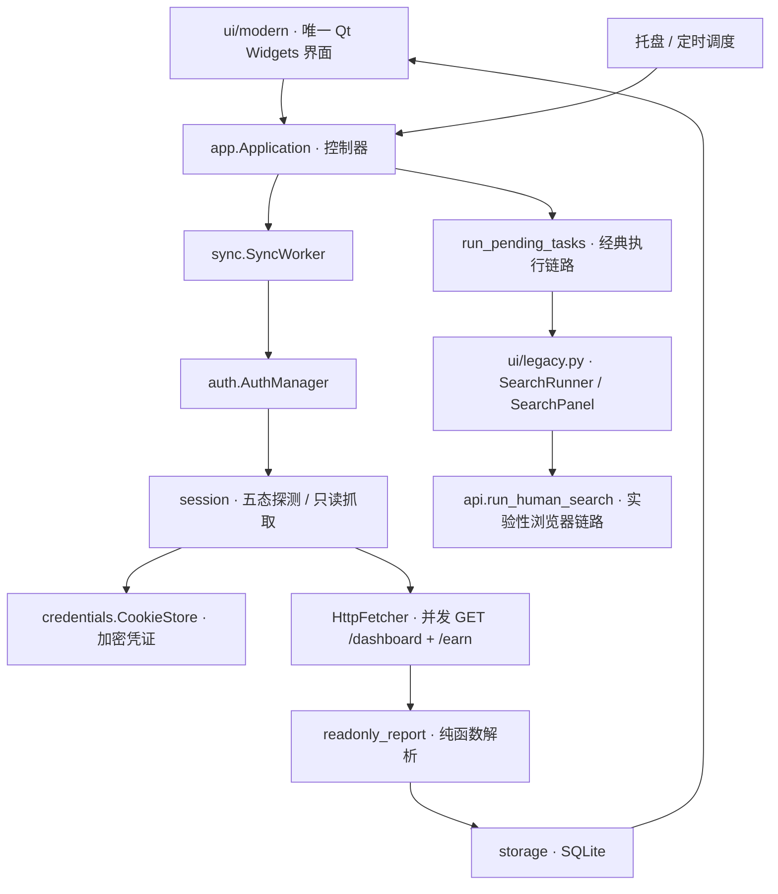
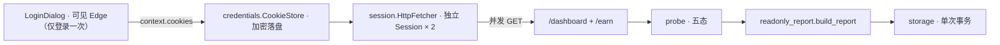

# 架构说明（2.2）

面向维护者的简要说明，描述当前版本的分层、数据流与设计约束。简介与安装说明见 [README.md](../README.md)。

## 分层



- **数据与解析层**（不依赖 Qt）：`credentials` / `session` / `auth` / `readonly_report` / `rewards_client` / `storage` / `points`。
- **桌面集成**：`sync` / `notifier` / `autostart`。
- **界面与控制器**：`ui/modern/` + `app.py`。`--widgets` / `--classic` 只是入口别名，不存在第二套窗口。

## 只读同步

`session.probe()` 用两页 HTML 与 HTTP 状态给出五态：`SIGNED_IN` / `SIGNED_OUT` / `DEGRADED` / `TRANSIENT_ERROR` / `UNKNOWN`。两页由 `HttpFetcher.fetch_many()` 用纯 HTTP **并发** GET（凭证来自加密的 `CookieStore`），同步路径不启动浏览器；网络错误不会被翻译成「凭证失效」。

`readonly_report.build_report()` 是零第三方依赖的纯函数：

1. 三项积分按「卡片标签 → 相邻数值」解析，RSC 字段兜底，两页合并；缺失为 `None`，不用任务合计反推，不写 0。
2. 任务卡同时吃 RSC `dailySetItems` 与可见 DOM 绿色徽章卡，按最近 `<h2>` 分组、两页去重。
3. `pointsCounters` 读不到返回 `None`（官方每日搜索上限按等级为 15 / 30 / 60 分，不硬编码 60/60）。
4. 识别登录页 / 公开「关于」页直接返回 `signed_out`。

落库时「今日积分」优先取页面显示值；失败保留上次快照并标记 stale，不覆盖、不清空任务。整段写入（批量 UPSERT 任务、余额、页面真值、刷新汇总）由可重入的 `Store.tx()` 包成一次 SQLite 事务。`to_legacy_dashboard()` 把结果转成 `rewards_client.parse_dashboard()` 能读的兼容结构，供经典链路复用。

## 设置映射

`ui/modern/viewmodel.py` 把可见控件直接写入经典 `Settings` 键，不是另存一套界面偏好：

| 控件 | 写入 |
| --- | --- |
| 自动刷新 | `sync_interval_minutes` + `sync_interval_value_minutes` |
| 任务提醒 | `remind_time` / `remind_time_value` / `evening_remind_time` / `evening_remind_time_value` |
| 后台与通知 | `notify_after_sync` / `silent_when_all_done` / `close_to_tray` |
| 拟人强度 低/中/高 | 一次写齐 `search_panel` 的 8 个执行参数；最多次数 20 / 16 / 12，实际次数 = min(ceil(剩余积分÷3), 上限) |
| 时间胶囊 | `auto_run_times`（最多 10 个；`+` 左侧输入框占位 `--:--`，四位数字自动补冒号，留空则 +30 分钟） |

隐藏项由 `defaults_patch()` 一次性写成推荐默认值（带迁移标记，不覆盖用户后续选择）；既有配置由 `intensity_upgrade_patch()` / `repeat_upgrade_patch()` 平滑升级。`config.SEARCH_PANEL_KEYS` 是持久化白名单，`SearchPanel._collect()` 负责把参数透传给 `api.run_human_search()`。

## 节奏与领取

`timing.jitter()` 是全链路唯一的随机时间来源：在 `[lo, hi]` 内取样并量化到 0.001 秒。搜索轮时长与轮间隔（`api.py`）、鼠标与粘贴停顿（`human.py`）、活动卡片点击与页面稳定等待（`activity_click.py` / `activity_worker.py`）、任务页打开间隔与倒计时（`opener.py`）、领取窗口关闭轮询（`claim.py`）、自动刷新周期（`app.py`）都走它；倒计时定时器按毫秒启动，日志与状态行用 `ms_text()` 显示三位小数，报告时间戳与耗时也保留毫秒。

「可领取」卡由 `claim_ready()` 统一把关（积分 > 0、登录态、凭证、无同步/运行/已有领取窗口、最近同步成功）。放行时 `StatCard` 变手形并在 `enterEvent` 把标签换成「点击领取」；点击后 `Application.open_claim_page()` 调 `StatusChip.set_green_hint()`，圆环下用完成态绿色显示「正在打开浏览器...」。领取窗口在后台线程里等用户关闭；正常关闭后 `claim_sync_requested` 回到主线程触发 `sync_now(auto=True)`，`claim_finished` 负责复位闸门。`stop_event` 被设置（应用退出）或窗口启动失败时不发同步信号。

**关闭检测失败也要刷新积分**：persistent context 被整体关掉时，各版本 Playwright 对 `page.is_closed()` / `wait_for_event("close")` 的表现并不一致（可能既不返回 closed 也不抛异常），单靠轮询会让「关窗后自动同步」永远不触发。因此 `claim.open_claim_window()` 同时注册 `page/context close` + `page crash` 回调、用 `page.wait_for_timeout()` 泵同步 API 的事件循环、再轮询 `page.is_closed()`；从**成功打开领取页**（`on_opened`）起计时，若 `CLAIM_SYNC_FALLBACK_SECONDS = 30` 秒内仍没捕获到关闭事件，就发 `claim_fallback_sync_requested` 让控制器兜底刷新一次积分状态，不强行关掉用户可能还在用的窗口。兜底与正常关窗共用 `_claim_sync_done` 去重，一次领取最多同步一次。`Application._on_claim_opened()` 只记 DEBUG 与状态行，不提前同步。

纯界面偏好只有 `ui_language` / `ui_theme` / `ui_calendar_view`。

## 搜索次数与强度档位

「拟人强度」不是摆设：切换档位会一次写齐经典 `SearchPanel` 的真实执行参数，中档的最多次数为 **16 轮**。每次自动完成任务的搜索次数只有一个公式：

```
次数 = min( ceil(搜索任务剩余积分 ÷ 3), 强度档位的最多次数 )
```

电脑端搜索每次计 3 分，剩余积分按官方同步快照的 `points_max - points_earned` 计算，向上取整。例如强度=中（最多 16 次）时：还剩 51 分 → `min(17, 16) = 16` 次；还剩 6 分 → `min(2, 16) = 2` 次。除此之外不叠加任何封顶、保底或按会员等级的额外限制；任务做完归 0，不启动浏览器。设置页首行「至多 N 轮，根据任务进度，目前搜索 M 轮」的 M 就是这个结果，显示值即执行值。

低 / 中 / 高 的最多次数分别为 **20 / 16 / 12 次**：强度越高单轮越慢、抖动越大，因此单次运行覆盖的轮数更少；剩余积分不足时一律按进度收敛。

| 展示项 | 低 | 中（默认） | 高 |
| --- | --- | --- | --- |
| 搜索轮数上限 | 至多 20 轮 | 至多 16 轮 | 至多 12 轮 |
| 单轮耗时 | 10–18 秒 | 16–29 秒 | 24–40 秒 |
| 回车提交 | 35% | 50% | 70% |
| 结果点击 | 20% | 35% | 55% |
| 滚动屏数 | 0.6 屏 | 1.2 屏 | 2 屏 |

## 同步链路：凭证与浏览器解耦

同步链路**完全不启动 Chromium**：登录窗口只为本人登录（含 MFA）打开一次可见 Edge，凭证随即加密落盘；之后两个 GET 由纯 HTTP 完成。



- `CookieStore` 加密保存会话 Cookie：Windows 用 DPAPI（`CryptProtectData`，绑定当前用户），其他平台用机器绑定种子 + PBKDF2-SHA256 派生密钥 + SHAKE256 流加密 + HMAC-SHA256 认证（encrypt-then-MAC），文件权限 0600、原子替换。损坏、篡改或换机器一律当作「尚未保存会话」，重新登录即可。**不读取日常 Edge 的 Cookie 数据库**（新版 app-bound encryption 且运行中 DB 被独占）。遗留的明文 `cookies.txt` 由 `migrate_legacy()` 一次性导入后删除。
- 只保留 `RELEVANT_SUFFIXES` 里的 Microsoft 相关域；无关站点 Cookie 不落盘、不随请求带出。
- `HttpFetcher.fetch_many()` 实现与 `BrowserSessionFetcher` 相同的 `ReadOnlyFetcher` 接口：每页一个独立 `requests.Session`（Session 不保证线程安全），两页在共享的固定 2 线程池里并发；单页异常只返回 `transient`，不误判登录失效。无凭证时直接返回 `signed_out`，连网络往返都省掉。
- `default_fetcher()` 恒返回 `HttpFetcher`。`BrowserSessionFetcher` 只保留给登录窗口与「退出登录」清理 profile 使用，不在同步热路径上；`profile_guard` 只保护登录 / 清理这两类低频浏览器操作。
- 会话工厂预检会真实构造一次 `requests.Session`：系统环境中若被 `lazy_import` 不可调用代理污染，整轮切到标准库 `urllib` 后端；运行时若仍遇到 `not callable`，该页再用标准库重试一次。两页始终并发，后端切换不改变五态判定。
- **登录对话框不堆说明文字**：`ui/login_guide.py` 用 `QPainter` 画 5 帧循环插画（点按钮 → 独立 Edge 里本人登录 → 短信 / 验证器确认 → 回来点「我已完成登录」→ 凭证加密留本机、只读两页），`QTimer` 40ms 驱动帧内微动（流动光点、光标浮动、按钮呼吸）与帧间交叉淡入，底部只留一行随帧切换的短句和 5 个步骤圆点。实时绘制不依赖打包环境未必提供的动图解码插件；`tools/render_login_guide.py` 用同一套 `paint_guide()` 离屏导出 `login_flow.gif` 与浅色 / 深色对话框预览。配色取自当前主题，状态行也统一走主题色，深色下可读。
- **状态行与主界面同源**：`sync_state.py` 在每次真正完成的同步后把时间、成功与否、失败原因摘要写入统一状态库 `kv[last_sync]`（库不可写时回退独立 JSON）；「距上次过近」的跳过不刷新时间戳。登录对话框打开时直接显示「最近同步：时间 · 同步成功 / 失败（原因）」，成功绿色、失败红色，两者加粗；只有从未同步过才回落到「尚未检测会话状态」，避免出现主界面已「已登录」、登录页却说没检测过的矛盾。退出登录 / 清除本地会话会一并清掉该记录。主界面顶栏的登录状态文字与标题同为 16px 加粗，只有文字变色：已登录金色、未登录红色、未检测中性；旁边的状态图标是 `icons.py` 里用 `QPainter` 复刻的 32×32 矢量奖章：细等宽橙环 + 白色圆盘 + 两条带 45° 斜纹的绶带 + 橙金渐变圆章（中央白勾），未登录态换成灰 / 深棕实心圆底与白色描边环、白色同款奖章；与左侧品牌图标同为 32px。不是 emoji 也不是截图素材，切换主题时随 `rebuild_ui()` 重新取色。

## 统一状态文件

`state.py` 把**积分库、设置、加密凭证、最近同步结果、两个缓存**全部收进当前实例目录下的一个 `rewards.db`；运行日志只有一份 `debug.log`。常态下应用自己写的文件就是这两个。

| 原来 | 现在 |
| --- | --- |
| `rewards.db` + `-wal` / `-shm` | `rewards.db`（`PRAGMA journal_mode=DELETE`，空闲无常驻附属文件） |
| `settings.json` | `kv[settings]`，且只存与 `DEFAULT_SETTINGS` 不同的 **delta** |
| `session_cookies.bin` | `kv[credentials]`，**密文 blob 原样搬入**，不解密不重加密 |
| `last_sync.json` | `kv[last_sync]` |
| `run.log` + `debug.log` 双写 | `debug.log` 一份；`run.log` 只是导出时过滤出的视图 |
| `search_actions.jsonl` | 同一日志里的 `ACTION ` 前缀行 |
| `~/.cache/human_search_*.json` | `kv[trends_cache]` / `kv[geo_cache]`，随实例隔离、受 `MS_REWARDS_HOME` 覆盖 |

`Store` 的 `daily` / `tasks` / `used_terms` 与 `kv` 表共用同一个文件；`state` 的每次读写都是显式 `close()` 的短连接 + `busy_timeout=5000`，不与 `Store` 的线程局部长连接抢事务。设置只存差异、日志只写一次、导出视图不落盘，避免重复信息。

**稳健性与备选方案**（`__main__.main()` 在构造 `Application` 之前调用 `state.ensure()` 与 `state.migrate_legacy()`）：

- 启动执行 `PRAGMA quick_check`；库损坏（非 SQLite 文件、页校验失败）→ **删除损坏文件** → 重建 schema → 回默认设置继续跑，并在 `debug.log` 留 WARN。需要排查时设 `MS_REWARDS_KEEP_CORRUPT=1` 保留一份带时间戳的副本。连重建都失败则转纯内存降级，不让应用起不来。
- 单个 kv 值坏 JSON / 凭证密文校验失败 → 只删除该项并回默认（设置回 `DEFAULT_SETTINGS`、凭证视为未登录），**不重建整库**，积分历史与其它状态不受影响。
- `kv_set` 失败（磁盘满、只读、权限不足）→ 返回 `False` 并标记降级；`Settings` / `CookieStore` / `sync_state` 各自回退到原来的独立文件 + 原子替换，内存态继续可用。两条路都写不进去时 `CookieStore.save()` 明确返回 0，绝不假装登录成功。
- 旧版四个状态文件、两份日志、两个 `~/.cache` 在首次启动时一次性迁移：凭证搬密文、坏文件按约定删除、旧日志追加进 `debug.log` 后删除；任何一步失败都保留原文件，下次启动重试。
- 保留 `default_instance.json` 与各 `instances/<id>/instance.json`：前者必须在**导入数据层之前**决定本进程实例 id，后者是 `list_instances()` 扫描目录时的身份锚点，两者都不能并进状态库。

## 积分赚取日历

`viewmodel._points_by_day()` 先把历史记录收敛成「有积分的日期」，未来 / 过去为 0 分的日期一律不进入界面：

- **日**：本月有积分的日子，一排七个紧凑卡片；
- **周**：本月涉及到的周（周一至周日），一排一周，标签如 `W3  11/9-11/15`，第二排是周合计，第三排 7 个圆点对应当天是否有积分；
- **月**：只列出有积分的月份，第三排圆点按该月各周是否有积分。

三种视图共用 `CalendarCell`（圆角矩形内三排：标签 / 蓝色粗体积分 / 圆点），`CalendarGrid` 按 `cell["unit"]` 决定 7 列或 1 列。`calendar_summary()` 的口径随视图变为日均 / 周均 / 月均，并给出最高与有积分的计数；图例是卡片内的第三排圆点。

七列必须严格等宽，所以数字标签保留 `QSizePolicy.Ignored`（不按内容撑宽列）；`CalendarCell.fit_value()` 在 `resizeEvent` 与 `CalendarGrid` 布局完成后的定时器里，用 `QFontMetrics` 按标签**实际拿到的宽度**收字号，保证四位数（日视图不带千分位）与带千分位的周 / 月合计都完整显示、不被 `QLabel` 裁掉，且保底 8pt（周 / 月 12pt）不会被无限缩小。日视图左右内边距 4px、列间距 5px，给数字留出余量。

补一次重排的定时器是 `CalendarGrid` 自己的子 `QTimer`（单次、可被 `clear_grid()` 停止），回调只遍历此刻仍挂载在网格上的格子；grid 销毁时定时器与信号连接一并消失，不会留下捕获旧控件列表的悬空回调。`CalendarCell._value_width()` 对已被删除的 C++ 对象返回 -1，让 `fit_value()` / `value_fits()` 在极端时序下静默退出而不是抛 `RuntimeError`。

## 自动完成任务

主页主按钮、托盘动作、快捷面板都调用 `Application.run_pending_tasks()`，与经典窗口同一份 Python 代码：

```
SyncWorker（同步未完成任务）→ ActivityWorker（活动卡点击）
→ SearchRunner / api.run_human_search（电脑端搜索）→ sync_now(auto=True)
```

这是**实验性链路**，但登录态与只读同步**同源**：都来自 `credentials.CookieStore` 的本机加密凭证。同步用 `HttpFetcher` 直接发 HTTP；自动化用 `browser.new_automation_profile_dir()` 创建一份**全新且空**的 user-data-dir，启动 Edge 后由 `inject_saved_cookies()` 用 `ctx.add_cookies()` 把凭证注入 context。

**不复制、不读取任何已有 profile**：Chromium 的 process singleton 按 user-data-dir 路径判定，唯一空目录即可断开这条链，没有 `SingletonLock` / `ProcessSingleton` / `shutil.Error`，登录窗口与后台同步也不与它抢目录。`playwright_cookies()` 负责把加密凭证转成 Playwright 结构：会话 Cookie（`expires <= 0`）必须省略 `expires`，迁移来的 hostless 项用 `url` 代替 `domain`/`path`；批量注入失败会逐条兜底并跳过畸形项。凭证为空时 `launch_automation_edge()` 直接抛「尚未保存登录会话」，不启动一个必定退出的浏览器。目录在运行结束后删除，最多保留 3 份历史；仅在极少数瞬时目录占用时换一份全新目录重试一次。

启动健壮性：`launch_edge()` 在 `channel="msedge"` 解析不到 Edge 时自动改用 `find_edge_binary()` 的绝对路径；`launch_automation_edge()` 对占用类错误换全新空目录重试、对参数不兼容类错误（`Unexpected option` / `no_viewport` / `permissions` 等）降级为最小参数集重试，其余错误（没装 Edge、凭证为空）直接给出明确提示、不空转。

日志与可观测性只有**一份文件** `debug.log`，提供 `debug / info / warn / error` 四级：界面流水是 INFO，浏览器启动阶段、活动卡片命中、搜索轮次、领取窗口事件是 DEBUG，`error` 附异常类型、完整 traceback 与 `__cause__` 链。结构化行为日志以 `ACTION ` 前缀行并进同一文件，不再是独立的 `search_actions.jsonl`。所有内容经 `session.redact()` 脱敏（凭证 / Bearer / token / 邮箱）后，再按 `browser_error_hint` 同款规则抹掉 `C:\Users\...` / `/home/...` 这类本机绝对路径；堆栈**逐行**脱敏。`debug_log_enabled`（默认开）或 `MS_REWARDS_DEBUG=0` 可关闭 DEBUG 细目，ERROR 详细记录始终写入；每个实例一份 `debug.log`。

`launch_automation_edge(log=...)` 把 `credentials`（凭证条数）、`profile`（全新空目录）、`edge`（启动成功/失败）、`cookies`（注入条数）逐阶段写进这唯一日志；`api.run_human_search()` 在启动异常分支先写 `browser_error: 异常类型: 原因`，再安全 `pw.stop()` 并以 `session_end error: 原因` 收尾，主循环异常的 `finally` 同样区分 `ok` / `error`。`SearchWorker` 先发一条单行完整原因（`error`），再把栈帧压成一行（`trace`）；界面日志上限 500 字符，原因不会被截断。导出日志 zip 时 `debug_log.run_log_view()` 按级别过滤出 `run.log` 视图（不含 DEBUG 与堆栈）、`action_log_view()` 还原 `search_actions.jsonl`，并把 `debug.log` 原样打进去——这些都是导出瞬间的视图，磁盘上不存第二份。`export_logs` / `capture_html` 的默认文件名与用户改名后的最终路径都经 `ensure_timestamped_zip()` 补 `YYYYmmdd_HHMMSS` 后缀，多次导出不互相覆盖；关键页面 zip 的 README 也记录导出时间。

运行期互斥：`Application.auto_running()` 为真时，`sync_now()` 直接拒绝手动同步、定时同步静默跳过；主按钮与托盘第 3 项切换为「停止自动运行」，主按钮同时通过 `danger` 动态属性切到红色 QSS（浅色 / 深色各一套），窗口统一禁用 `act_sync` / 圆环，并锁定停止按钮防连点；顶栏品牌图标是纯展示 `QLabel`，不随运行状态禁用。

主页交互：`RingProgress` 是 `QAbstractButton`，本身就是唯一的显式手动刷新入口（任务卡头部不设文字按钮）。hover 时 1500ms 无限呼吸动画驱动光晕透明度、弧宽、外扩 2px、末端高光点、中心字号，圆环内小字从「今日任务」换成「点击刷新」——用内置文字而非悬浮提示框表达可点击性；移出 / 禁用立即归零。顶栏左侧不再是放大镜按钮：早期那枚 `🔍` 同时充当刷新入口，语义与「积分管理助手」主题都不贴；现在换成 `assets/icons/brand.svg` 的**积分奖章**（橙色渐变圆环 + 白色五角星），是纯展示 `QLabel#brandIcon`，不绑定 `clicked`、不触发刷新。齿轮也改用 `assets/icons/gear.svg` 矢量图标（替代高度随字体变化的 `⚙` emoji），`icons.py` 的 `brand_pixmap()` / `gear_pixmap()` 优先渲染 SVG，资源缺失时用 QPainter 画同款造型兜底。品牌图标 / 标题 / 登录状态 / 齿轮由 `TOPBAR_ROW_H = 32` 与 `QLabel#topTitle` / `QPushButton#topAction` 的 QSS 固定**等高、统一 16px 字号**，登录状态奖章与左侧品牌图标同为 32×32；刷新只由圆环承担，运行期或同步期点击圆环直接 return。任务行的 `numBadge` 统一使用绿色圆角徽章，搜索 60 分与活动 `+10` 完全一致。整轮结束的 `running → idle` 边沿调用 `_on_auto_run_finished()`，只补一次同步（`_post_run_sync_pending` 去重）。活动点击期间不做任何官方接口核验 / 请求，活动与搜索之间也不插入同步，避免同步与浏览器任务并行；同步结束后状态行从「正在…」切换为完成态，不会残留。

**自动完成任务全程共用一个浏览器**：Playwright 同步对象绑定创建它的线程/greenlet，跨线程复用会报 `Cannot switch to a different thread`。旧实现里 `ActivityWorker` 点完卡片就关掉 Edge、`SearchWorker` 再起一份全新 Playwright + Edge，用户看到的就是「浏览器关掉又重新打开」。现在 `_start_activity_clicks()` 用 `SearchRunner.for_pending()` 预先算好搜索参数，`ActivityWorker(..., search_params=...)` 在同一个线程里持有唯一的 `pw` / `context` / `page`：点击阶段结束后把该对象注入 `api.run_human_search(page=..., context=..., close_browser=False)` 续跑拟人搜索，`finally` 里才统一 `ctx.close()` / `pw.stop()` / 清理临时 profile。整轮只有一次 Edge 启动、一次关闭；`_on_activity_completed()` 只汇总 `stats["search"]`，不再调用 `_start_pc_search()`，运行期也不插同步。只有「没有活动卡片、只跑搜索」时才由 `SearchRunner` 独立启动一次浏览器。

Microsoft Rewards 要求奖励搜索由本人手动进行，不建议用它获取积分；详见 README 的合规章节。

## 构建

`build_ubuntu.sh` / `build_windows.bat` / `build_deb.sh` / `build_macos.sh` 都使用统一的 `MSRewardsAssistant.spec`：图标、可选字体、Playwright 驱动由 spec 收集，Qt 模块交给 PyInstaller 官方 hook 按 import 图收集；`shiboken6` 动态库显式平铺到 `_internal` 根目录并由 `normalize_bundle.py` 校验。`.deb` 的版本号取自 `config.APP_VERSION`（当前 `2.2`）。构建一律使用系统 Python（不创建虚拟环境），避免 `site-packages` 混用引入 `lazy_import` 代理污染；源码运行时仍可用虚拟环境。Windows 侧构建脚本与 `tools/normalize_bundle.py` 的输出保持纯 ASCII，并对 stdout / stderr 设 `backslashreplace`：CI 以管道捕获输出（cp1252），`chcp` 不作用于管道，中文路径与消息都不会让构建中断。

Windows 安装包由 `installer/setup.iss`（Inno Setup 6/7）生成单文件 `MSRewardsAssistantSetup.exe`，版本号同为 `2.2`：向导语言按系统 UI 自动选（`LanguageDetectionMethod=uilanguage` + `ShowLanguageDialog=no`，english 列在首位作回落，自定义文案放在 `Messages.en.isl` / `Messages.zh.isl`）；`PrivilegesRequired=lowest` + `OverridesAllowed=dialog` 提供「为所有用户安装 / 仅为我安装」，`{autopf}` 让一条 `DefaultDirName` 同时适配两种模式；`[Code]` 在 `InitializeSetup` 里按 AppId 查 HKCU / HKLM 卸载项、等待旧版静默卸载完成再装（只清 `{app}`，用户数据目录不动）；完成页的中英双语「打开」复选框由 `[Run] postinstall skipifsilent` 提供。详见 [installer/README.md](../installer/README.md)。

macOS 由 `build_macos.sh` 产出 `dist/MSRewardsAssistant.app` 与 `macos-dist/MSRewardsAssistant_2.2_<架构>.dmg`。spec 在 `sys.platform == 'darwin'` 时用 `BUNDLE(coll, ...)` 把同一个 COLLECT 结果封成应用包：PyInstaller 6 会按代码签名规则把二进制放进 `Contents/Frameworks`、数据放进 `Contents/Resources` 并做交叉链接，同时完成 ad-hoc 签名，脚本只做 `--verify --deep --strict` 校验，不重复签名。应用图标由系统自带的 `sips` + `iconutil` 从 PNG 生成 `.icns`；DMG 用 `ditto` 保留签名与链接、`hdiutil` 生成 UDZO 压缩镜像并附 `/Applications` 链接。产物架构跟随构建机（arm64 或 x86_64），不做 universal2 合并，也不做 Developer ID 签名与公证。Info.plist 版本由 `BUNDLE(version=APP_VERSION)` 写入，与 `.deb` / Windows 同源于 `config.APP_VERSION`。

依赖按用途分成三份清单，互不夹带：`requirements.txt` 只装运行时（`PySide6-Essentials` / `requests` / `playwright`），`requirements-build.txt` 追加 `pyinstaller`，`requirements-dev.txt` 追加 `pytest`。Qt 只用 Essentials 的核心模块，不安装 `PySide6-Addons`（QtWebEngine / Qt3D / QtCharts / QtMultimedia 均为项目不需要的扩展）。`requests` 是首选 HTTP 后端，缺失时 `HttpFetcher` 自动切到标准库 `urllib`。

`.github/workflows/build.yml` 把上述流程自动化：`test` job 先补 `libegl1` / `libgl1` 等 Qt 基础运行库（offscreen 只选平台插件，`libQt6Gui.so.6` 在 import 阶段就要解析 `libEGL.so.1`）并验证 Qt 模块可导入，再在 Qt offscreen 下跑离线测试与脚本语法检查；`ubuntu` job 在 ubuntu-22.04 上补齐 Qt xcb 运行库（该发行版缺 `libxcb-cursor0` 时降级为非致命警告）后调用 `build_deb.sh`，产出 `.deb`；`windows` job 在 windows-latest 上先跑 `build_windows.bat`，再用 Chocolatey 装的 Inno Setup 执行 `build_inno.bat --no-build`（不加 `--quiet`，保留 ISCC 日志），产出单文件 exe；cmd 步骤显式传递退出码。`macos` job 在 macos-latest 上运行 `build_macos.sh`，校验 `Info.plist` 版本、cocoa 平台插件、代码签名与 DMG 可读性后上传 `.dmg`。三个产物各作为 artifact 保留 30 天，推送 `v*` 标签时由 `release` job 先确认三平台包齐全再挂到 GitHub Release。Ubuntu 选 22.04 是为了让 glibc 基线覆盖更老的目标系统；版本号由 `config.APP_VERSION` 与 `setup.iss` 的 `MyAppVersion` 提供，macOS 由 spec 的 `BUNDLE` 读取同一个常量，workflow 不重复维护。

## 实现约束与性能设计

- **数据类全部启用 `@dataclass(slots=True)`**：`readonly_report` 的 `Card` / `Group` / `Report` / `SearchCounter`、`session` 的两个状态类，以及 `rewards_client` / `api` / `context` / `engines` / `geo` / `trends` 里的记录类型，去掉每实例 `__dict__`。`sync.sync_once()` 用显式 `card_as_dict()` 展开 `Card`，与 slots 兼容且不产生递归深拷贝。
- **解析热路径正则模块级预编译**：`num_from` / `clean_text` / `structured_items_from` 共用的正则集中在模块顶部编译一次，卡片字段提取走 `_first_group()`；`_heading_sections()` 一次扫描全页 `<h2>`，`visible_cards_from()` 用二分查找取最近分组，避免逐卡回扫整页 HTML。
- **凭证派生密钥进程内有界缓存**：`_pbkdf2_key(seed, nonce)` 用 `lru_cache(maxsize=8)` 缓存 PBKDF2(120k) 结果。`load()` 每次仍读文件、验 HMAC-SHA256、解密；缓存键含完整机器种子与文件自带 nonce，换机器 / 换实例 / 重新保存都会重新派生，`maxsize` 限制缓存不超过 8 份 32 字节密钥。密文 XOR 用整块整数运算完成。
- **抓取复用**：两页并发共用一个模块级固定 2 线程池，避免按小时反复同步时反复创建销毁线程；`requests.Session` 预检结果按类对象缓存（有界），单测替换 `Session` 时会自动重新预检。两页始终各自独立的 Session / opener 并发 GET，不共享连接池。
- **HTML 解码按页进行**：DOM 徽章卡用原始 HTML，RSC / 积分卡用解码后的 HTML。`build_report()` 逐页「解码 → 解析 → 释放」，任何时刻最多驻留一份解码副本；`decode_payload()` 对无转义引号的普通 HTML 直接返回原串，不产生副本。`sync_once()` 在解析完成后立即断开 `PageResult.html` 的引用，写库与兼容桥构造期间不再持有两页大字符串。
- **落库一次提交**：`Store.tx()` 可重入，任务批量 UPSERT、余额、页面真值与刷新汇总包成一个事务；`SyncWorker` 退出时 `close_thread_connection()` 关闭线程局部连接，不积累句柄。
- **设置页正文字号单一来源**：`theme.stylesheet()` 的 `QLabel#body` 为 13px，与 `widgets.Row` 外观卡标签的 `font-size:13px` 一致；设置页构造段、5 行拟人参数、环境行名称与状态标记全部用这个 objectName，不再混用 `#tiny` 的 11px 或内联 12px。主页的 `#tiny` 徽章、卡片标题、编号与胶囊字号保持原样。`tools/render_previews.py` 离屏断言所有 `#body` 标签 `pixelSize()==13`，防止截图里正文字号漂移。
- **跨层 helper 单一来源**：`row_access.get_field()` 统一 `sqlite3.Row` / dict / 对象的「缺字段返回默认值」规则，`sync` 与 `viewmodel` 共用同一函数；命中字段时直接下标取值，不做额外类型判断。浏览器启动错误分类共用 `browser._error_matches()`，淡入动画的结束清理共用 `effects._clear_fade()` / `_fade_restore()`。
- **界面数据构造保持轻量**：`Settings` 复制 `DEFAULT_SETTINGS` 时只递归处理内建容器、标量直接返回；`viewmodel` 的 `timedelta` 在模块级导入，`calendar_week()` 一周只遍历一次，同时得到每天圆点状态与周合计；`group_tasks()` / `_points_by_day()` 的行取值走 `get_field()` 命中路径。
- **只读口径**：只 GET `/dashboard` 与 `/earn` 两个白名单页面，不 POST、不点击、不搜索、不领取、不注入脚本；读不到不写 0、失败保留快照、运行期不同步。
- **账号数据独立删除**：设置页「运行环境」的当前环境那一行提供两道确认的「删除账号」入口（均默认「否」），本机账号不再单独成卡，执行 `AuthManager().logout()` 清除当前实例的加密凭证、遗留明文文件与应用独立 profile 登录态；积分历史、设置与其它环境不动，删除后由本人重新登录。
- **启动默认环境与环境删除**：`config.preferred_default_id()` 读根目录 `default_instance.json` 的指针，不带 `--instance` 时决定进入哪个环境；`__main__.main()` 在导入数据层前把 id 固定进环境变量，因此运行中改指针只影响下次启动。`instances._entry()` 为每行给出 `is_builtin_default` / `is_preferred_default` / `can_delete` / `can_set_default`，设置页据此把删除键放在名称旁：只允许删当前环境，内置根目录（同时是 `instances/` 的父目录）与启动默认环境都不显示删除键。`instances.delete_instance()` 用 `shutil.rmtree()` 只删 `instances/<id>/`，先清自启动项、再由界面关掉当前进程，避免 SQLite / 运行日志把目录重新建回来；两道确认均默认「否」。

链路细节与约束以源码注释为准；本文件只描述当前结构，不记录开发过程。
